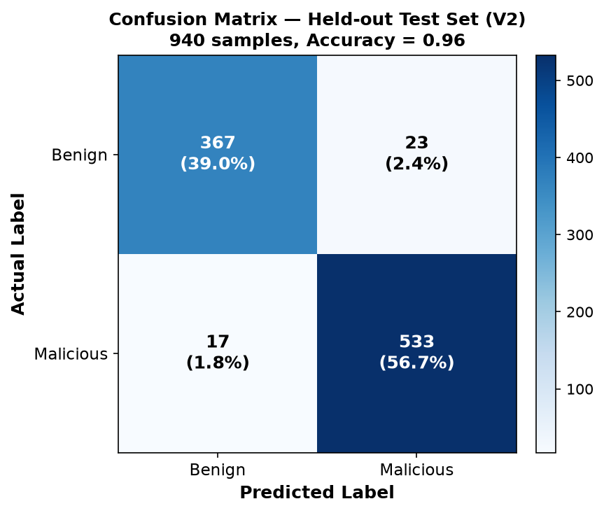

# Qwen3 Prompt Injection Detector

A fine-tuned LLM-based security classifier built using **Qwen3-1.7B and QLoRA** to detect prompt injection and jailbreak attempts.

As LLMs become integrated into applications, they increasingly interact with untrusted user inputs, external documents, and retrieved content. These inputs can contain malicious instructions designed to override system prompts, manipulate model behavior, or bypass application-level safeguards.

This project explores parameter-efficient fine-tuning of a small language model to identify potentially malicious inputs and classify them by **label, attack category, and severity**.

Rather than relying on a general-purpose LLM to detect threats through prompting alone, the project fine-tunes Qwen3-1.7B on a labeled prompt-injection dataset using 4-bit quantization and Low-Rank Adaptation (LoRA).

Two training notebooks are included:
- `FineTunedQwenThreatClassifierV1.ipynb` — initial exploratory pass.
- `FineTunedQwenThreatClassifierV2.ipynb` — improved, production-oriented version with proper validation, Qwen-native chat formatting, expanded LoRA coverage, model merging, and held-out test evaluation. **V2 is the recommended version.**

## Results at a glance

### Training

| Metric | V1 | V2 |
|---|---:|---:|
| Base model | Qwen3-1.7B | Qwen3-1.7B |
| Fine-tuning method | QLoRA | QLoRA |
| Quantization | 4-bit NF4 | 4-bit NF4 |
| Double quantization | Enabled | Enabled |
| LoRA rank | 8 | 8 |
| LoRA alpha | 32 | 32 |
| LoRA dropout | 0.05 | 0.05 |
| LoRA target modules | `q_proj` | `q_proj`, `v_proj` |
| Mixed precision | BF16 | FP16 |
| Training steps | 500 | 500 |
| Training time | ~26 min | ~41 min |
| Trainable parameters | 917,504 | ~1.8M |
| Trainable parameter percentage | ~0.0533% | ~0.107% |
| Final validation loss | 2.3910 | **0.3561** |
| Final mean token accuracy | 61.7% | **93.4%** |

### Training progress (V2)

| Step | Training Loss | Validation Loss | Mean Token Accuracy |
|---:|---:|---:|---:|
| 100 | 0.5729 | 0.4784 | 92.26% |
| 200 | 0.4979 | 0.3917 | 93.07% |
| 300 | 0.4625 | 0.3704 | 93.31% |
| 400 | 0.4033 | 0.3604 | 93.40% |
| 500 | 0.4319 | 0.3561 | 93.45% |

Validation loss decreased consistently throughout the run, indicating stable generalization without overfitting.

### Threat detection evaluation (V2, held-out test set)

The merged model was evaluated on a separate held-out test dataset (940 samples after filtering).

| Metric | Result |
|---|---:|
| Accuracy | **0.96** |
| Precision (Benign / Malicious) | 0.96 / 0.96 |
| Recall (Benign / Malicious) | 0.94 / 0.97 |
| F1 (Benign / Malicious) | 0.95 / 0.96 |
| Macro F1 | 0.96 |
| False Positive Rate | ~5.9% (23 / 390) |
| False Negative Rate | ~3.1% (17 / 552) |
| Invalid predictions | 2 / 940 |



Confusion matrix (rows = actual, columns = predicted):

| | Pred: Benign | Pred: Malicious |
|---|---:|---:|
| **Actual: Benign** | 367 | 23 |
| **Actual: Malicious** | 17 | 533 |

*Inference: batched (batch size 4), greedy decoding, 40 max new tokens, ~4.8 samples/sec, ~196 seconds total.*

## Features

- Fine-tuning of **Qwen3-1.7B** for prompt injection and jailbreak detection.
- Parameter-efficient training using **QLoRA**.
- 4-bit NF4 quantization with double quantization.
- LoRA adapters to update a small fraction of model parameters.
- **V2:** Qwen-native conversational formatting through `tokenizer.apply_chat_template()` with a detailed system prompt.
- **V2:** Proper train / validation / test splits (V1 used only train + test).
- **V2:** LoRA applied to both `q_proj` and `v_proj` attention projections (V1 used `q_proj` only).
- **V2:** FP16 mixed precision for T4 GPU compatibility.
- Structured classification output containing:
  - **Label:** benign (0) or malicious (1).
  - **Category:** attack category.
  - **Severity:** predicted threat severity.
- Dataset filtering and preprocessing using Hugging Face Datasets.
- Validation-based training monitoring.
- Held-out test evaluation with classification report and confusion matrix.
- **V2:** Model saving — PEFT adapter (`./qwen-threat-classifier-adapter`) and merged standalone FP16 model (`./qwen-threat-classifier-merged`).
- Prediction-level error analysis.

## Model and dataset

### Base model

[Qwen3-1.7B](https://huggingface.co/Qwen/Qwen3-1.7B)

Qwen3-1.7B serves as the base language model. Its weights are loaded in 4-bit precision, while trainable LoRA adapters learn the threat-classification task.

### Dataset

[neuralchemy/Prompt-injection-dataset](https://huggingface.co/datasets/neuralchemy/Prompt-injection-dataset)

The project uses the `full` configuration of the Prompt Injection Dataset.

The dataset contains labeled examples covering benign inputs and multiple prompt injection attack categories.

Dataset splits:

| Split | Purpose |
|---|---|
| Training | Fine-tuning the model |
| Validation | Monitoring generalization during training (V2 only) |
| Test | Final held-out evaluation |

The dataset's labels, categories, and severity annotations are used to construct structured supervised fine-tuning targets.

## How it works

The project follows a supervised fine-tuning pipeline.

1. **Dataset loading:** Load the prompt-injection dataset using Hugging Face Datasets.
2. **Preprocessing:** Filter and prepare the examples containing input text, label, category, and severity.
3. **Conversational formatting:** Convert each example into a system-user-assistant conversation using Qwen3's native chat template (V2) or a hand-rolled template (V1).
4. **Quantization:** Load the base model in 4-bit NF4 precision to reduce memory requirements.
5. **LoRA configuration:** Attach trainable low-rank adapters to selected model modules while keeping the quantized base weights frozen.
6. **Fine-tuning:** Train the adapters on the formatted dataset.
7. **Validation:** Monitor training and validation loss throughout training.
8. **Evaluation:** Generate predictions on the held-out test set and compare them against ground-truth annotations.
9. **Error analysis:** Inspect incorrect predictions and evaluate classification performance.
10. **V2: Model merge:** Merge LoRA adapters into the base model for standalone deployment.

## QLoRA configuration

QLoRA combines quantization with Low-Rank Adaptation to make fine-tuning large language models more memory-efficient.

The base model is quantized and kept frozen. Instead of updating all model parameters, training updates small LoRA matrices attached to selected linear layers.

| Configuration | Value |
|---|---|
| Quantization type | NF4 |
| Quantization bits | 4 |
| Double quantization | Enabled |
| Compute dtype | FP16 (V2) / BF16 (V1) |
| LoRA rank (`r`) | 8 |
| LoRA alpha | 32 |
| LoRA dropout | 0.05 |
| LoRA target modules | `q_proj`, `v_proj` (V2) / `q_proj` (V1) |
| Optimizer | Paged AdamW 8-bit |
| Learning rate | 2e-4 |
| Training steps | 500 |
| Effective batch size | 16 (batch size 4 × gradient accumulation 4) |
| Max sequence length | 512 |

Only approximately **0.0533%** (V1) / **~0.107%** (V2) of the model's parameters were trainable during fine-tuning.

This substantially reduces the number of parameters requiring gradient updates compared with full fine-tuning.

## Evaluation methodology

Training loss and validation loss alone do not establish whether a model is an effective security classifier.

The final evaluation therefore uses generated predictions on the held-out test set.

### Classification metrics

- **Accuracy:** Overall proportion of correctly classified examples.
- **Precision:** Proportion of predicted malicious examples that are actually malicious.
- **Recall:** Proportion of actual malicious examples successfully detected.
- **Macro F1:** Unweighted average F1 across classes, giving each class equal importance.
- **Confusion matrix:** Breakdown of correct and incorrect predictions across classes.
- **False positive rate:** Proportion of benign examples incorrectly flagged as malicious.
- **False negative rate:** Proportion of malicious examples incorrectly classified as benign.

For security-oriented classification, false negatives are particularly important because they represent malicious inputs that the detector fails to identify.

### Structured output evaluation

In addition to the primary benign/malicious classification task, the model is evaluated on:

- Attack category prediction.
- Severity prediction.

Macro F1 is used to assess performance across the category and severity classes.

### Error analysis

Incorrect predictions are retained for further inspection. This helps identify:

- Missed malicious inputs.
- Benign inputs incorrectly flagged as attacks.
- Incorrect attack-category predictions.
- Severity misclassification.

## Tech stack

- **Python** — Core implementation.
- **PyTorch** — Model training and tensor operations.
- **Hugging Face Transformers** — Model loading, tokenization, and generation.
- **Hugging Face Datasets** — Dataset loading and preprocessing.
- **PEFT** — Parameter-efficient fine-tuning with LoRA.
- **bitsandbytes** — 4-bit quantization and memory-efficient optimization.
- **TRL** — Supervised fine-tuning workflow (SFTTrainer, SFTConfig).
- **scikit-learn** — Classification metrics and confusion matrix.
- **Matplotlib** — Evaluation visualizations.
- **torchao** (V2) — Model weight merging utilities.

## Repository structure

```text
.
├── FineTunedQwenThreatClassifierV1.ipynb
├── FineTunedQwenThreatClassifierV2.ipynb
├── assets/
│   ├── training-results.png
│   └── confusion-matrix.png
├── README.md
├── IMPLEMENTATION_EXPLANATION.md
└── ...
```

## Running the project

### Prerequisites

- Python 3.10+
- PyTorch with CUDA support
- A compatible NVIDIA GPU (T4 used in development)
- Hugging Face account (for model and dataset access)

### 1. Clone the repository

```bash
git clone https://github.com/YOUR_USERNAME/Qwen3-Prompt-Injection-Detector.git
cd Qwen3-Prompt-Injection-Detector
```

### 2. Install dependencies

```bash
pip install -U transformers datasets accelerate peft
pip install -U bitsandbytes trl
pip install -U scikit-learn matplotlib pandas
# V2 model merging
pip install -U torchao
```

### 3. Load the dataset

```python
from datasets import load_dataset

dataset = load_dataset(
    "neuralchemy/Prompt-injection-dataset",
    "full"
)

train = dataset["train"]
val = dataset["validation"]
test = dataset["test"]
```

### 4. Run the training notebook

Open `FineTunedQwenThreatClassifierV2.ipynb` (recommended) or `FineTunedQwenThreatClassifierV1.ipynb` and execute the notebook cells in sequence.

The notebook covers:

- Dataset preparation.
- Qwen3 chat-template formatting (V2).
- 4-bit model loading.
- LoRA configuration.
- Supervised fine-tuning.
- Validation monitoring.
- Test-set prediction and evaluation.
- Model adapter saving and merging (V2).

## Limitations and future improvements

This project is an experimental prompt-injection classifier, not a complete LLM application security solution.

Potential improvements include:

- Evaluate generalization on independently sourced prompt-injection datasets.
- Test against previously unseen attack categories and adversarially modified prompts.
- Compare different LoRA ranks and target-module configurations.
- Compare the fine-tuned model against the original base model using an identical evaluation protocol.
- Evaluate inference latency, throughput, and GPU memory consumption.
- Explore confidence calibration and threshold-based classification.
- Integrate the classifier into an LLM application as an additional input-screening layer.

A standalone classifier should not be treated as a substitute for robust system-prompt design, tool permissions, input validation, and application-level security controls.

## Acknowledgements

- [Qwen](https://huggingface.co/Qwen) for the Qwen3 model family.
- [Hugging Face](https://huggingface.co/) for the Transformers, Datasets, and PEFT ecosystem.
- [neuralchemy](https://huggingface.co/neuralchemy) for the Prompt Injection Dataset.

---

**Built as an exploration of parameter-efficient fine-tuning and LLM application security.**